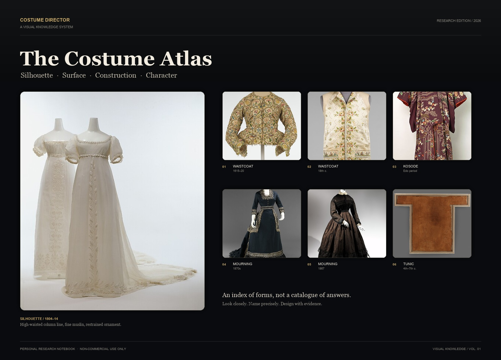
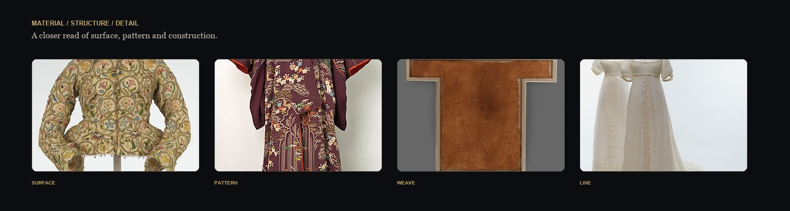
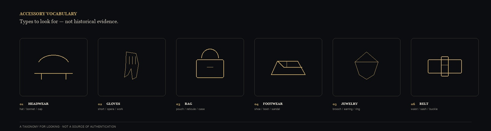

<p align="center">
  
</p>

<h1 align="center">Costume Director</h1>

<p align="center">
  <b>A visual knowledge base for costume, silhouette and character</b><br>
  <sub>Silhouette · Surface · Construction · Character</sub>
</p>

<p align="center">
  <a href="README.md">中文</a> ·
  <a href="README.en.md">English</a> ·
  <a href="README.ko.md">한국어</a> ·
  <a href="README.ja.md">日本語</a> ·
  <a href="README.fr.md">Français</a>
</p>

<p align="center">
  <sub>Personal research project · Non-commercial use · Obsidian + Markdown + DSH Skill</sub>
</p>

---

## About

This is a personally maintained visual knowledge base for costume. It turns garment structures, materials, garments, styles and complete outfits into searchable Obsidian cards, with visual notes, English image prompts and reference-image status for each card. It is made for costume design, character styling and visual research — not as a commercial product.

## Why this repository exists

The hardest part of costume design is rarely knowing a word. It is turning that word back into a visual fact:

- How exactly does this collar roll, where does it sit, and how does it differ from a nearby collar type?
- How does this material catch light, fall, crease and move?
- What is the silhouette, volume and proportion of this garment, and how is it worn?
- Which top, bottom, outer layer, shoes and accessories make up this outfit?
- How do these judgements become reproducible prompts rather than a pile of adjectives?

This repository treats those “visible facts” as a working atlas: something to look at closely, combine and test.

> Not garments as labels, but labels returned to shape, weight, light and character.

## The atlas at a glance

<p align="center">
  
</p>

<p align="center">
  <sub>Surface / Pattern / Weave / Line — from overall silhouette into local construction.</sub>
</p>
<p align="center">
  
</p>

<p align="center">
  <sub>Headwear, gloves, bags, footwear, jewellery, belts — a taxonomy for looking, not historical evidence.</sub>
</p>


## What is inside

| Module | Contents | What it helps you do |
|---|---|---|
| **Structure cards** | Collars, sleeves, closures, pleats, waistlines, cuffs, crinolines | Compare nearby structures and find the decisive geometry |
| **Material cards** | Fibre, weave, surface, lustre, drape, weight and movement | Turn “it looks like…” into testable material facts |
| **Garment cards** | Tops, bottoms, one-pieces, outerwear, shoes, hats and accessories | Move from a garment into fit, construction and wearing |
| **Style cards** | Historical styles, contemporary styles, subcultures and theatrical languages | Read proportion, colour, material composition and period context |
| **Outfit cards** | Complete character looks, scene, role, shoes, accessories and continuity | Combine garments into a shootable, generateable, reusable look |
| **Visual prompts** | English prompts for structure, material, garment, style and outfit | Copy into an image workflow or use as visual communication |
| **Reference status** | Verified references, pending images and reasons for gaps | Separate “image found”, “licensed”, “linked” and “visible in Obsidian” |

## Knowledge chain

The repository is not a pile of isolated cards. It is a chain from person to object:

```text
Character / scene
    ↓
Complete outfit
    ↓
Top · bottom · outer layer · shoes · accessories
    ↓
Structure / material / pattern
    ↓
Visual features · English prompts · reference-image status
```

Each card keeps its evidence level, scope and uncertainty. **Unknown stays unknown**: fibre, weight, weave, transparency or historical detail without reliable support is not written as fact.

## Visual language

This is not a “vintage filter”. It is a design system for reading costume:

| Element | Value | Use |
|---|---|---|
| Obsidian Black | `#090B0E` | Main ground, like a dark stage |
| Parchment | `#F3ECE0` | Body and titles, like patterns and manuscripts |
| Antique Gold | `#C8A96A` | Index numbers and emphasis |
| Graphite | `#2A2B2E` | Rules and card borders |
| Display Serif | Georgia / serif | Titles and narrative |
| Work Sans | Arial / system sans | Labels, parameters and notes |

The layout follows “whole first, detail second”: a hero image establishes silhouette, a detail strip enters material and construction, then cards and tables carry the searchable information.

## Core capabilities

### 01 · Structure recognition

Break “collar”, “sleeve” or “pleat” into location, geometry, connection and front/side/back views — not just a name.

### 02 · Material reading

Describe surface, lustre, texture scale, transparency, drape and movement. Properties without evidence remain `unknown`.

### 03 · Garment to character

Move from a garment’s cut, length, ease and shoulder-waist-hip proportion into a worn state, then into character and scene.

### 04 · Complete outfit

Build a look from top, bottom, outer layer, shoes, accessories, colour and silhouette while keeping role, narrative context and cross-shot continuity.

### 05 · Style comparison

Compare proportion, colour organisation, material mix and typical garments across styles — avoiding prompts that only swap names.

### 06 · Prompt expression

Use modular English prompts for `SUBJECT / STRUCTURE / MATERIAL / COLOR / LIGHT / CAMERA / BACKGROUND / STYLE / NEGATIVE / CONSISTENCY`, so visual judgements can be copied, edited and tested.

## How to use

### In Obsidian

1. Open the repository root as an Obsidian vault;
2. Start from `00-系统/MOC`;
3. Read down the chain: style → outfit → garment → structure / material;
4. Inside each card, check visual references, English prompts and related cards;
5. Images use relative paths; keep the directory structure when moving the vault.

### In DSH / an agent

Ask naturally, for example:

- “Compare the structure of two collar types. Give me card IDs, English prompts and reference-image status.”
- “Build a complete 1930s Shanghai woman intellectual look: top, bottom, shoes, accessories and cross-shot anchors.”
- “What surface should this material have under light? Mark unsupported properties as unknown.”
- “Apply modern minimalism and deconstruction to the same character; give two structurally different solutions.”

The agent should return real card IDs, evidence status, reference-image status and prompts. **It must not describe text generation as image generation.**

## Quality and boundaries

| Dimension | Current status |
|---|---|
| Text and structure checks | Established |
| Domain review | Pending per-card human review |
| Real image testing | Not run (no authorised image tool in this environment) |
| Human visual approval | Not run |
| Historical / cultural accuracy | Needs case-by-case source and specialist review |
| GUI acceptance | Not run |

This is a **research workbench**, not a history textbook, rights clearance, professional costume-consulting opinion or commercial deliverable. A prompt passing text checks does not mean an image will be accurate; having a reference image does not mean it can be used commercially.

## Rights and usage

**This repository is a personal, non-commercial research notebook, shared for study, research and personal creative reference only.**

- Do not use it in commercial productions, film/TV projects, client work, paid courses, paid templates, resale or any profit-making distribution;
- Do not use its contents for commercial model training, bulk scraping or redistribution;
- The repository does not grant any rights to third-party material, images, brands or historical documents;
- For commercial use, obtain the necessary rights and professional permissions yourself;
- If you are unsure whether an image or passage can be used, treat it as reference-only: do not copy, embed or republish it.

**No commercial licence is granted.** This repository is not a substitute for copyright, historical or legal advice.

## Project status

- Edition: **R1.3B / Research Edition**
- Form: Obsidian Markdown + DSH Costume Director Skill
- Scope: structure, material, garment, style, complete outfit, visual prompts
- Current focus: reference-image evidence, professional prompt distinction, real image testing and human visual review
- Principle: **evidence before expression; structure before adjectives; verification before reuse.**

## Contents

- [About](#about)
- [Why this repository exists](#why-this-repository-exists)
- [The atlas at a glance](#the-atlas-at-a-glance)
- [What is inside](#what-is-inside)
- [Knowledge chain](#knowledge-chain)
- [Visual language](#visual-language)
- [Core capabilities](#core-capabilities)
- [How to use](#how-to-use)
- [Quality and boundaries](#quality-and-boundaries)
- [Rights and usage](#rights-and-usage)
- [Project status](#project-status)

---

<p align="center">
  <sub>Costume Director · A personal visual research notebook · Non-commercial use only</sub>
</p>
