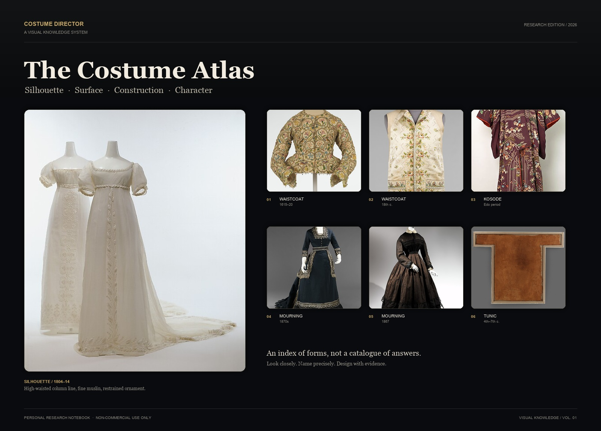
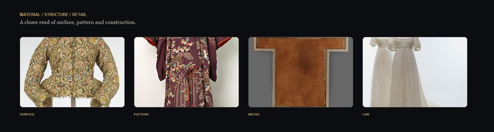
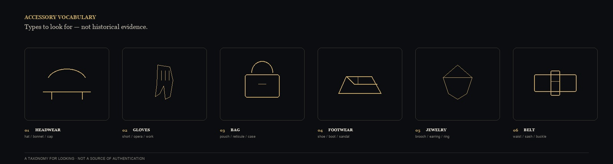
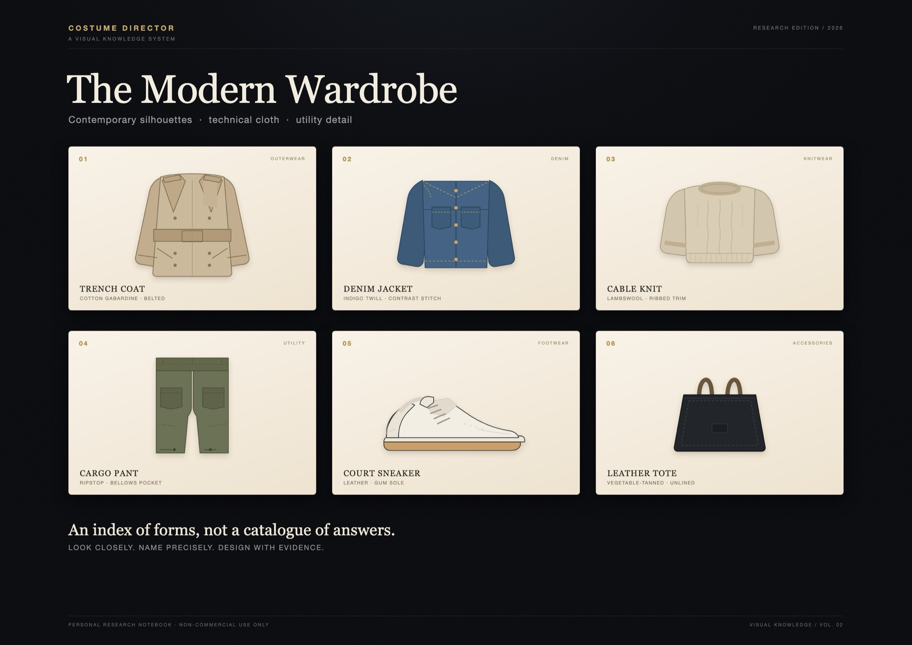

<p align="center">
  
</p>

<h1 align="center">Costume Director</h1>

<p align="center" data-ecosystem-nav="1"><sub><a href="https://github.com/YanKaFei/Costume-Director-Vault-Starter">Costume</a> · <a href="https://github.com/YanKaFei/art-aesthetic-vault">Art</a> · <a href="https://github.com/YanKaFei/ascii-cinema-engine">ASCII Cinema</a> · <a href="https://github.com/YanKaFei/ascii-h3-director">ASCII H3</a> · <a href="https://github.com/YanKaFei/2d-limited-mv-studio">2D MV</a> · <a href="https://github.com/YanKaFei/virtual-heroine-atlas">Virtual Heroine</a></sub></p>


<p align="center">
  <b>Une base de connaissances visuelles pour le costume, la silhouette et le personnage</b><br>
  <sub>Silhouette · Surface · Construction · Character</sub>
</p>

<p align="center">
  <a href="README.md">中文</a> ·
  <a href="README.en.md">English</a> ·
  <a href="README.ko.md">한국어</a> ·
  <a href="README.ja.md">日本語</a> ·
  <a href="README.fr.md">Français</a>
</p>

<p align="center">
  <sub>Projet de recherche personnel · Usage non commercial · Obsidian + Markdown + DSH Skill</sub>
</p>

---

## Sommaire

- [À propos](#à-propos)
- [Pourquoi ce dépôt](#pourquoi-ce-dépôt)
- [L’atlas en un coup d’œil](#latlas-en-un-coup-dœil)
- [Instantané des données](#instantané-des-données)
- [Ce que contient le dépôt](#ce-que-contient-le-dépôt)
- [La chaîne de connaissance](#la-chaîne-de-connaissance)
- [Langage visuel](#langage-visuel)
- [Capacités principales](#capacités-principales)
- [Comment l’utiliser](#comment-lutiliser)
- [Qualité et limites](#qualité-et-limites)
- [Droits et conditions d’utilisation](#droits-et-conditions-dutilisation)
- [État du projet](#état-du-projet)

## À propos

Ce dépôt est une base de connaissances visuelles sur le costume, tenue à titre personnel. Il transforme les structures de vêtements, les matières, les pièces, les styles et les silhouettes complètes en fiches Obsidian interrogeables, avec des notes visuelles, des prompts d’image en anglais et l’état des images de référence pour chaque fiche. Il est destiné au design de costume, au stylisme de personnage et à la recherche visuelle — ce n’est pas un produit commercial.

## Pourquoi ce dépôt

Le plus difficile, dans le design de costume, n’est pas de connaître un mot. C’est de transformer ce mot en **fait visible** :

- Comment ce col roule-t-il exactement, où se situe-t-il, et en quoi diffère-t-il d’un col voisin ?
- Comment cette matière réagit-elle à la lumière, tombe-t-elle, se plisse-t-elle et bouge-t-elle ?
- Quelle est la silhouette, le volume et la proportion de cette pièce, et comment se porte-t-elle ?
- Quels hauts, bas, couches extérieures, chaussures et accessoires composent cette silhouette ?
- Comment ces jugements deviennent-ils des prompts reproductibles plutôt qu’une accumulation d’adjectifs ?

Ce dépôt traite ces « faits visibles » comme un atlas de travail : quelque chose à regarder de près, à combiner et à tester.

> Non pas des vêtements réduits à des étiquettes, mais des étiquettes rendues à la forme, au poids, à la lumière et au personnage.

## L’atlas en un coup d’œil

<p align="center">
  
</p>

<p align="center">
  <sub>Surface / Pattern / Weave / Line — de la silhouette d’ensemble à la construction locale.</sub>
</p>
<p align="center">
  
</p>

<p align="center">
  <sub>Coiffes, gants, sacs, chaussures, bijoux, ceintures — une taxonomie pour regarder, pas une preuve historique.</sub>
</p>


<p align="center">
  
</p>

<p align="center">
  <sub>Un vestiaire moderne : trench, denim, maille, pantalon cargo, sneaker, cabas — silhouette, matière et détail fonctionnel contemporains.</sub>
</p>

## Instantané des données

En novembre 2026, le dépôt contient :

| Type de fiche | Nombre |
|---|---|
| Vêtement | 92 |
| Structure (garment_part) | 35 |
| Matière / motif | 19 |
| Style | 26 |
| Silhouette complète (look) | 35 |
| Scène | 16 |
| Époque / région | 11 |
| Source | 239 |
| **Total** | **473** |

- Prompts en anglais : 218 fiches
- Images de référence : 15 fiches, dont 7 aperçus CC0 locaux

## Ce que contient le dépôt

| Module | Contenu | Ce que cela permet |
|---|---|---|
| **Fiches structure** | Cols, manches, fermetures, plis, lignes de taille, poignets, crinolines | Comparer des structures proches et trouver la différence géométrique décisive |
| **Fiches matière** | Fibre, armure, surface, lustre, tombé, poids et mouvement | Transformer « cela ressemble à… » en faits matériels vérifiables |
| **Fiches pièce** | Hauts, bas, robes, manteaux, chaussures, chapeaux et accessoires | Passer de la pièce à la coupe, à la structure et au porté |
| **Fiches style** | Styles historiques, contemporains, sous-cultures et langages théâtraux | Lire proportions, couleurs, compositions de matières et contexte d’époque |
| **Fiches silhouette (Outfit)** | Looks complets, scène, rôle, chaussures, accessoires et continuité | Assembler des pièces en un look photographiable, générable et réutilisable |
| **Prompts visuels** | Prompts anglais pour structure, matière, pièce, style et silhouette | À copier dans un flux d’images ou à utiliser comme langage visuel |
| **État des références** | Références vérifiées, images en attente, raisons des manques | Distinguer « image trouvée », « autorisée », « liée » et « visible dans Obsidian » |

## La chaîne de connaissance

Le dépôt n’est pas un tas de fiches isolées. C’est une chaîne du personnage vers l’objet :

```text
Personnage / scène
    ↓
Silhouette complète
    ↓
Haut · bas · couche extérieure · chaussures · accessoires
    ↓
Structure / matière / motif
    ↓
Traits visuels · prompts anglais · état des images de référence
```

Chaque fiche conserve son niveau de preuve, son périmètre et son incertitude. **L’inconnu reste inconnu** : une fibre, un poids, une armure, une transparence ou un détail historique sans appui fiable n’est pas écrit comme un fait.

## Langage visuel

Ce n’est pas un « filtre vintage ». C’est un système de design pour lire le costume :

| Élément | Valeur | Usage |
|---|---|---|
| Obsidian Black | `#090B0E` | Fond principal, comme une scène sombre |
| Parchment | `#F3ECE0` | Texte et titres, comme patrons et manuscrits |
| Antique Gold | `#C8A96A` | Index et accents |
| Graphite | `#2A2B2E` | Filets et bordures de fiches |
| Display Serif | Georgia / serif | Titres et narration |
| Work Sans | Arial / sans-serif système | Libellés, paramètres, notes |

La mise en page suit « l’ensemble d’abord, le détail ensuite » : une image principale installe la silhouette, une bande de détails entre dans la matière et la construction, puis les fiches et les tableaux portent l’information interrogeable.

## Capacités principales

### 01 · Reconnaissance des structures

Décomposer « col », « manche » ou « pli » en emplacement, géométrie, connexion et vues face/profil/dos — pas seulement en nom.

### 02 · Lecture des matières

Décrire surface, lustre, échelle de texture, transparence, tombé et mouvement. Les propriétés sans preuve restent `unknown`.

### 03 · De la pièce au personnage

Passer de la coupe, de la longueur, de l’aisance et des proportions épaules-taille-hanches à l’état porté, puis au personnage et à la scène.

### 04 · Silhouette complète

Composer un look avec haut, bas, couche extérieure, chaussures, accessoires, couleur et silhouette, en conservant rôle, contexte narratif et continuité entre plans.

### 05 · Comparaison des styles

Comparer proportions, organisation des couleurs, mélange de matières et pièces typiques entre styles — en évitant les prompts qui ne font que changer le nom.

### 06 · Expression par prompt

Utiliser des prompts anglais modulaires : `SUBJECT / STRUCTURE / MATERIAL / COLOR / LIGHT / CAMERA / BACKGROUND / STYLE / NEGATIVE / CONSISTENCY`, pour rendre les jugements visuels copiables, modifiables et testables.

## Comment l’utiliser

### Dans Obsidian

1. Ouvrir la racine du dépôt comme vault Obsidian ;
2. Commencer par `00-系统/MOC` ;
3. Lire la chaîne : style → silhouette → pièce → structure / matière ;
4. Dans chaque fiche, consulter les références visuelles, les prompts anglais et les fiches liées ;
5. Les images utilisent des chemins relatifs : conserver l’arborescence lors du déplacement du vault.

### Dans DSH / un agent

Poser une question en langage naturel, par exemple :

- « Compare la structure de deux types de col. Donne-moi les ID de fiches, les prompts anglais et l’état des images de référence. »
- « Compose une silhouette complète pour une intellectuelle shanghaïenne des années 1930 : haut, bas, chaussures, accessoires et ancrages entre plans. »
- « Quelle surface cette matière doit-elle montrer sous la lumière ? Marque comme unknown ce qui n’est pas documenté. »
- « Applique le minimalisme moderne et la déconstruction au même personnage ; propose deux solutions structurellement différentes. »

L’agent doit renvoyer de vrais ID de fiches, l’état des preuves, l’état des images de référence et les prompts. **Il ne doit pas présenter une génération de texte comme une génération d’image.**

## Qualité et limites

| Dimension | État actuel |
|---|---|
| Vérification texte et structure | Établie |
| Revue professionnelle | En attente d’une revue humaine fiche par fiche |
| Test réel d’images | Non exécuté (aucun outil d’image autorisé dans cet environnement) |
| Validation visuelle humaine | Non exécutée |
| Exactitude historique / culturelle | Nécessite une vérification au cas par cas |
| Validation GUI | Non exécutée |

Ce dépôt est un **atelier de recherche**, pas un manuel d’histoire, une autorisation de droits, un avis professionnel de costume ni une livraison commerciale. Un prompt qui passe les contrôles textuels ne garantit pas une image exacte ; une image de référence disponible ne signifie pas qu’elle est utilisable commercialement.

## Droits et conditions d’utilisation

**Ce dépôt est un carnet de recherche personnel et non commercial, partagé uniquement pour l’étude, la recherche et la référence créative personnelle.**

- Ne pas l’utiliser dans des productions commerciales, des projets audiovisuels, des travaux clients, des cours payants, des modèles payants, la revente ou toute distribution à but lucratif ;
- Ne pas utiliser son contenu pour l’entraînement de modèles commerciaux, l’extraction massive ou la redistribution ;
- Le dépôt ne concède aucun droit sur des matériaux, images, marques ou documents historiques de tiers ;
- Pour un usage commercial, obtenir soi-même les droits et autorisations professionnelles nécessaires ;
- En cas de doute sur une image ou un passage, le traiter comme une référence consultable : ne pas le copier, l’intégrer ou le republier.

**No commercial licence is granted.** Ce dépôt ne concède aucune licence commerciale et ne remplace pas un avis juridique, historique ou professionnel.

## État du projet

- Édition : **R1.3B / Research Edition**
- Forme : Obsidian Markdown + DSH Costume Director Skill
- Périmètre : structure, matière, pièce, style, silhouette complète, prompts visuels
- Priorité actuelle : preuves des images de référence, distinction professionnelle des prompts, tests réels d’images, revue visuelle humaine
- Principe : **la preuve avant l’expression ; la structure avant les adjectifs ; la vérification avant la réutilisation.**

---

<p align="center">
  <sub>Costume Director · Carnet de recherche visuelle personnel · Usage non commercial uniquement</sub>
</p>


## DSH ecosystem

- [Costume](https://github.com/YanKaFei/Costume-Director-Vault-Starter) — connaissances visuelles du costume
- [Art](https://github.com/YanKaFei/art-aesthetic-vault) — couches de style art et cinéma
- [ASCII Cinema](https://github.com/YanKaFei/ascii-cinema-engine) — cinéma en grille de caractères
- [ASCII H3](https://github.com/YanKaFei/ascii-h3-director) — direction ASCII / typographie cinétique
- [2D MV](https://github.com/YanKaFei/2d-limited-mv-studio) — package de prompts MV anime 2D
- [Virtual Heroine](https://github.com/YanKaFei/virtual-heroine-atlas) — recherche sur les personnages virtuels
