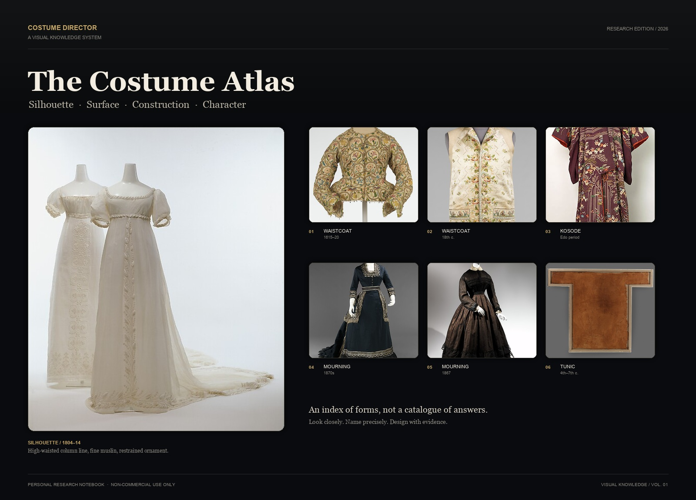
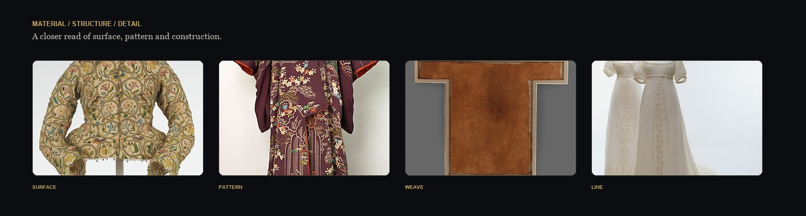
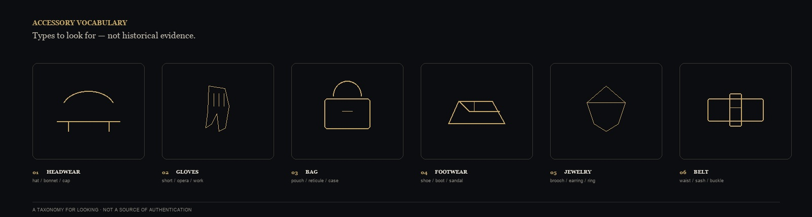

<p align="center">
  
</p>

<h1 align="center">Costume Director</h1>

<p align="center">
  <b>衣装・シルエット・キャラクターのための視覚知識ベース</b><br>
  <sub>Silhouette · Surface · Construction · Character</sub>
</p>

<p align="center">
  <a href="README.md">中文</a> ·
  <a href="README.en.md">English</a> ·
  <a href="README.ko.md">한국어</a> ·
  <a href="README.ja.md">日本語</a> ·
  <a href="README.fr.md">Français</a>
</p>

<p align="center">
  <sub>個人研究プロジェクト · 非営利利用 · Obsidian + Markdown + DSH Skill</sub>
</p>

---

## 目次

- [このリポジトリについて](#このリポジトリについて)
- [なぜこのリポジトリを作ったのか](#なぜこのリポジトリを作ったのか)
- [アトラスを一望する](#アトラスを一望する)
- [リポジトリの構成](#リポジトリの構成)
- [知識の連鎖](#知識の連鎖)
- [視覚言語](#視覚言語)
- [中核的な能力](#中核的な能力)
- [使い方](#使い方)
- [品質と境界](#品質と境界)
- [利用条件と注意](#利用条件と注意)
- [プロジェクト状態](#プロジェクト状態)

## このリポジトリについて

これは個人が管理する衣装の視覚知識ベースです。衣装の構造、素材、アイテム、スタイル、完成したコーディネートを検索可能な Obsidian カードとして整理し、各カードに視覚的特徴、英語の画像プロンプト、参考画像の状態を添えています。衣装デザイン、キャラクタースタイリング、視覚研究のための資料であり、商用製品ではありません。

## なぜこのリポジトリを作ったのか

衣装デザインで難しいのは、言葉を知ることではなく、その言葉を「見える事実」に戻すことです。

- この襟は具体的にどう折れ、どこに位置し、近い襟型と何が違うのか。
- この素材は光の下でどんな表面、ドレープ、シワを見せるのか。
- このアイテムはどんなシルエットと比率で、どう着用するのか。
- このルックは、トップス、ボトムス、アウター、靴、アクセサリーでどう構成されるのか。
- その判断を、形容詞の山ではなく再現可能なプロンプトにするにはどうすればよいか。

このリポジトリは、そうした「見える知識」を、近くで見て、組み合わせ、検証できる作業用アトラスにしようとする試みです。

> 衣装をラベルとして書くのではなく、ラベルを形・重さ・光・人物へ戻すこと。

## アトラスを一望する

<p align="center">
  
</p>

<p align="center">
  <sub>Surface / Pattern / Weave / Line — 全体のシルエットから局部構造へ。</sub>
</p>
<p align="center">
  
</p>

<p align="center">
  <sub>頭飾り、手袋、鞄、履物、ジュエリー、ベルト——観察のための分類であり、歴史的実物の証拠ではありません。</sub>
</p>


## リポジトリの構成

| モジュール | 内容 | できること |
|---|---|---|
| **構造カード** | 襟、袖、前開き、プリーツ、ウエストライン、袖口、クリノリンなど | 近い構造を比較し、決定的な幾何差を見つける |
| **素材カード** | 繊維、織り、表面、光沢、ドレープ、厚み、動き | 「似ている」を検証可能な素材特徴に分解する |
| **アイテムカード** | トップス、ボトムス、ワンピース、アウター、靴、帽子、アクセサリー | アイテムからフィット、構造、着用方法へ進む |
| **スタイルカード** | 歴史的スタイル、現代スタイル、サブカルチャー、演劇的表現 | 比率、色彩、素材構成、時代背景を読む |
| **コーディネートカード（Outfit）** | 完成した人物ルック、場面、役割、靴、アクセサリー、連続性 | アイテムを撮影・生成・再利用可能なルックに組み上げる |
| **視覚プロンプト** | 構造・素材・アイテム・スタイル・コーディネート用の英語プロンプト | 画像制作ワークフローにコピー、または視覚的コミュニケーションに使う |
| **参考画像の状態** | 検証済み参考、画像待ち、欠落理由 | 「画像がある」「許諾がある」「関連付けた」「Obsidian で表示される」を区別する |

## 知識の連鎖

このリポジトリは孤立したカードの山ではなく、人物から物へ向かう連鎖です。

```text
人物 / 場面
    ↓
完成したコーディネート
    ↓
トップス · ボトムス · アウター · 靴 · アクセサリー
    ↓
構造 / 素材 / 文様
    ↓
視覚的特徴 · 英語プロンプト · 参考画像の状態
```

各カードは証拠レベル、適用範囲、不確実性を保持します。**わからないことは、わからないままにします。** 信頼できる根拠のない繊維、目付、織り、透明感、歴史的細部を事実として書きません。

## 視覚言語

これは「ヴィンテージ風フィルター」ではなく、衣装を読むためのデザインシステムです。

| 要素 | 値 | 用途 |
|---|---|---|
| Obsidian Black | `#090B0E` | メイン背景、暗い舞台 |
| Parchment | `#F3ECE0` | 本文と見出し、型紙と原稿 |
| Antique Gold | `#C8A96A` | 索引番号と強調 |
| Graphite | `#2A2B2E` | 区切り線とカード境界 |
| Display Serif | Georgia / 明朝 | 見出しと物語 |
| Work Sans | Arial / システムサンセリフ | ラベル、パラメータ、注記 |

レイアウトは「全体を先に、細部を次に」に従います。ヒーロー画像がシルエットを立ち上げ、ディテール帯が素材と構造へ入り、カードと表が検索可能な情報を担います。

## 中核的な能力

### 01 · 構造の識別

「襟」「袖」「プリーツ」を、位置、幾何形状、接続、正面・側面・背面の視点に分解します。名前だけを示しません。

### 02 · 素材を読む

表面組織、光沢、質感のスケール、透明感、ドレープ、動きを記述します。根拠のない物性は `unknown` のままにします。

### 03 · アイテムから人物へ

アイテムの裁断、丈、ゆとり、肩・腰・ヒップの比率から着用状態へ、さらに人物と場面へ展開します。

### 04 · 完成したコーディネート

トップス、ボトムス、アウター、靴、アクセサリー、色、シルエットで一つのルックを構成し、役割、物語文脈、カット間の連続性を保ちます。

### 05 · スタイル比較

スタイル間の比率、色彩構成、素材の組み合わせ、代表アイテムを比較します。名前だけを入れ替える同質的な説明を避けます。

### 06 · プロンプト表現

`SUBJECT / STRUCTURE / MATERIAL / COLOR / LIGHT / CAMERA / BACKGROUND / STYLE / NEGATIVE / CONSISTENCY` のモジュール式英語プロンプトで、視覚判断をコピー・編集・検証可能にします。

## 使い方

### Obsidian

1. リポジトリのルートを Obsidian vault として開く。
2. `00-系统/MOC` から始める。
3. スタイル → コーディネート → アイテム → 構造 / 素材の順に読む。
4. カード内で視覚参考、英語プロンプト、関連カードを確認する。
5. 画像は相対パスを使うため、vault を移動するときはディレクトリ構造を保つ。

### DSH / Agent

自然言語で質問します。例：

- 「二つの襟型の構造差を比較し、カード ID、英語プロンプト、参考画像の状態を教えて。」
- 「1930年代上海の女性知識人に向けた完全なルックを、トップス、ボトムス、靴、アクセサリー、カット間アンカーまで構成して。」
- 「この素材が光の下でどんな表面になるべきか、根拠のない部分は unknown として示して。」
- 「現代ミニマリズムとデコンストラクションを同じ人物に適用し、構造的に異なる二案を出して。」

Agent は実在するカード ID、証拠状態、参考画像の状態、プロンプトを返すべきです。**テキスト生成を画像生成と言ってはいけません。**

## インストール / Quickstart

```bash
git clone https://github.com/YanKaFei/Costume-Director-Vault-Starter.git
cd Costume-Director-Vault-Starter
python3 -c "import yaml"  # なければ: python3 -m pip install pyyaml
# skills/costume-director を DSH profile の skills ディレクトリへコピー
```

- 詳細手順: [docs/QUICKSTART.md](docs/QUICKSTART.md)
- 公開範囲と制限: [docs/PUBLIC-PREVIEW.md](docs/PUBLIC-PREVIEW.md)

## コピーできるデモ 3 つ

1. **襟の比較:** `python3 scripts/visual_prompt.py --id STR-0028 --kind component_detail --markdown`、続けて `STR-0012`。連続したロールでノッチなしの襟と、ノッチ付きラペルの差を見ます。
2. **1930年代上海の完成ルック:** `python3 scripts/visual_prompt.py --id LOOK-0009 --kind outfit --markdown`。旗袍、盤扣、袖、サイドスリット、靴、色を見ます。
3. **現代ミニマル vs デコンストラクション:** `STY-0024` と `STY-0025` を `--kind style` で実行。シルエット、構造論理、素材構成を比較します。

- 詳細: [docs/DEMOS.md](docs/DEMOS.md)
- すべてテキストプロンプトで、**画像は生成しません**。

## ライセンス

個人・非営利の研究プレビューです。閲覧・学習・個人創作の参考は可能ですが、商用利用、再販、再配布、商用モデル学習は禁止です。全文: [LICENSE](LICENSE).

## 品質と境界

| 項目 | 現状 |
|---|---|
| テキスト・構造チェック | 構築済み |
| 専門領域レビュー | カードごとの人によるレビュー待ち |
| 実画像テスト | 未実行（現在の環境に承認された画像ツールなし） |
| 人による視覚承認 | 未実行 |
| 歴史・文化の正確性 | 出典と専門判断による個別確認が必要 |
| GUI 承認 | 未実行 |

このリポジトリは**研究用の作業台**であり、歴史教科書、権利許諾書、専門的な衣装コンサルティング、商用納品物ではありません。テキストチェックを通ったプロンプトが正確な画像を保証するわけではなく、参考画像があるからといって商用利用できるわけでもありません。

## 利用条件と注意

**このリポジトリは個人的・非営利の研究ノートであり、学習、研究、個人創作の参考のためにのみ共有されています。**

- 商業演劇、映像プロジェクト、クライアントワーク、有料講座、有料テンプレート、転売、収益目的の配布に使用しないでください。
- リポジトリの内容を商業モデルの学習、大量収集、再配布に使用しないでください。
- 本リポジトリは、第三者の素材、画像、ブランド、歴史資料に関するいかなる権利も付与しません。
- 商用利用の場合は、必要な権利と専門的許諾を自ら取得してください。
- 画像や文章の利用可否が不明な場合は「閲覧用の参考」として扱い、コピー、埋め込み、再公開をしないでください。

**No commercial licence is granted.** 本リポジトリは商用利用の許諾を与えるものではなく、著作権・歴史・法務上の助言の代わりにもなりません。

## プロジェクト状態

- エディション：**R1.3B / Research Edition**
- 形態：Obsidian Markdown + DSH Costume Director Skill
- 範囲：構造、素材、アイテム、スタイル、完成コーディネート、視覚プロンプト
- 現在の焦点：参考画像の証拠、プロンプトの専門的差異、実画像テスト、人による視覚レビュー
- 原則：**証拠が表現より先、構造が形容詞より先、検証が再利用より先。**

---

<p align="center">
  <sub>Costume Director · 個人の視覚研究ノート · 非営利利用のみ</sub>
</p>
