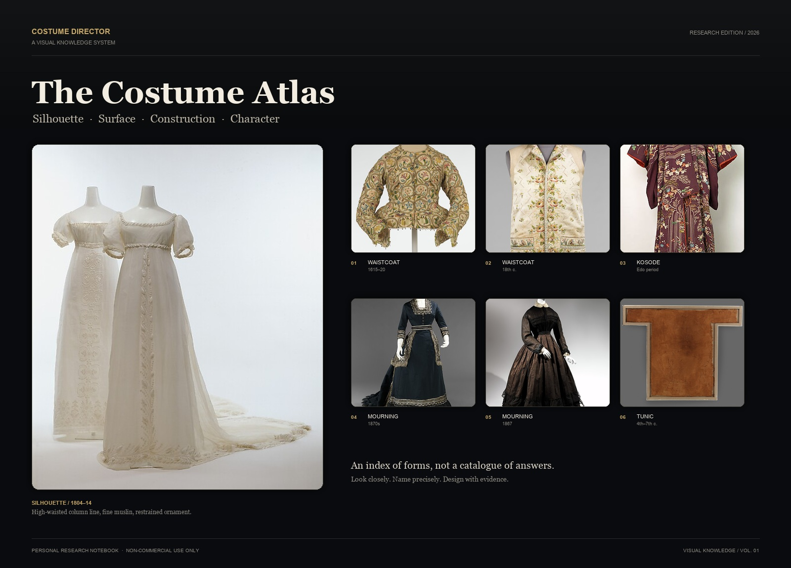
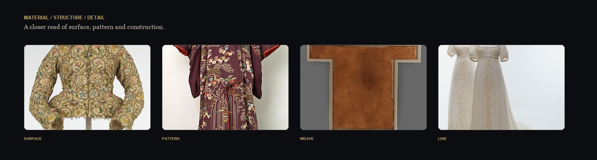
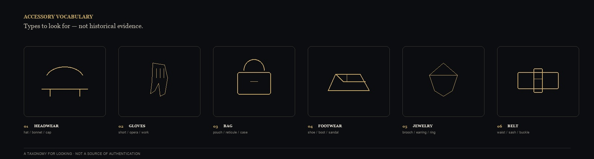

<p align="center">
  
</p>

<h1 align="center">Costume Director</h1>

<p align="center">
  <b>의상·실루엣·캐릭터를 위한 시각 지식 베이스</b><br>
  <sub>Silhouette · Surface · Construction · Character</sub>
</p>

<p align="center">
  <a href="README.md">中文</a> ·
  <a href="README.en.md">English</a> ·
  <a href="README.ko.md">한국어</a> ·
  <a href="README.ja.md">日本語</a> ·
  <a href="README.fr.md">Français</a>
</p>

<p align="center">
  <sub>개인 연구 프로젝트 · 비상업적 사용 · Obsidian + Markdown + DSH Skill</sub>
</p>

---

## 목차

- [소개](#소개)
- [이 저장소를 만든 이유](#이-저장소를-만든-이유)
- [한눈에 보는 아틀라스](#한눈에-보는-아틀라스)
- [저장소 구성](#저장소-구성)
- [지식의 사슬](#지식의-사슬)
- [시각 언어](#시각-언어)
- [핵심 역량](#핵심-역량)
- [사용 방법](#사용-방법)
- [품질과 경계](#품질과-경계)
- [사용 권리와 고지](#사용-권리와-고지)
- [프로젝트 상태](#프로젝트-상태)

## 소개

이 저장소는 개인이 관리하는 의상 시각 지식 베이스입니다. 의상 구조, 소재, 아이템, 스타일, 완성된 코디를 검색 가능한 Obsidian 카드로 정리하고, 각 카드에 시각적 특징, 영어 이미지 프롬프트, 참고 이미지 상태를 덧붙입니다. 의상 디자인, 캐릭터 스타일링, 시각 연구를 위한 자료이며 상업적 제품이 아닙니다.

## 이 저장소를 만든 이유

의상 디자인에서 어려운 것은 단어를 아는 일이 아니라, 그 단어를 다시 **보이는 사실**로 되돌리는 일입니다.

- 이 칼라는 정확히 어떻게 접히고, 어디에 위치하며, 비슷한 칼라와 무엇이 다른가?
- 이 소재는 빛 아래에서 어떤 표면, 어떤 낙하, 어떤 주름을 보이는가?
- 이 아이템은 어떤 실루엣과 비율을 가지며, 어떻게 입는가?
- 이 룩은 어떤 상의, 하의, 아우터, 신발, 액세서리로 구성되는가?
- 이런 판단을 어떻게 재현 가능한 프롬프트로 만들 수 있는가?

이 저장소는 그 “보이는 지식”을 가까이 보고, 조합하고, 검증할 수 있는 작업용 아틀라스로 만들고자 합니다.

> 의상을 라벨로 쓰는 것이 아니라, 라벨을 다시 형태·무게·빛·캐릭터로 되돌리는 일.

## 한눈에 보는 아틀라스

<p align="center">
  
</p>

<p align="center">
  <sub>Surface / Pattern / Weave / Line — 전체 실루엣에서 국부 구조로.</sub>
</p>
<p align="center">
  
</p>

<p align="center">
  <sub>모자, 장갑, 가방, 신발, 주얼리, 벨트 — 관찰을 위한 분류이며 역사적 실물 증거가 아닙니다.</sub>
</p>


## 저장소 구성

| 모듈 | 내용 | 활용 |
|---|---|---|
| **구조 카드** | 칼라, 소매, 여밈, 주름, 허리선, 커프스, 크리놀린 등 | 가까운 구조를 비교하고 결정적 기하 차이를 찾기 |
| **소재 카드** | 섬유, 직조, 표면, 광택, 드레이프, 두께와 움직임 | “비슷해 보인다”를 검증 가능한 소재 특징으로 바꾸기 |
| **아이템 카드** | 상의, 하의, 원피스, 아우터, 신발, 모자, 액세서리 | 아이템에서 핏·구조·착용 방식으로 들어가기 |
| **스타일 카드** | 역사적 스타일, 현대 스타일, 서브컬처, 연극적 언어 | 비율, 색, 소재 조합, 시대 맥락 읽기 |
| **코디 카드(Outfit)** | 완성된 캐릭터 룩, 장면, 역할, 신발, 액세서리, 연속성 | 아이템을 촬영·생성·재사용 가능한 룩으로 조합 |
| **시각 프롬프트** | 구조·소재·아이템·스타일·코디용 영어 프롬프트 | 이미지 워크플로에 복사하거나 시각 커뮤니케이션에 사용 |
| **참고 이미지 상태** | 검증된 참고, 대기 중인 이미지, 부재 이유 | “이미지 찾음”, “라이선스 있음”, “연결됨”, “Obsidian에 표시됨”을 구분 |

## 지식의 사슬

이 저장소는 고립된 카드 더미가 아니라 **사람에서 사물로** 이어지는 사슬입니다.

```text
캐릭터 / 장면
    ↓
완성된 코디
    ↓
상의 · 하의 · 아우터 · 신발 · 액세서리
    ↓
구조 / 소재 / 패턴
    ↓
시각 특징 · 영어 프롬프트 · 참고 이미지 상태
```

각 카드는 증거 수준, 적용 범위, 불확실성을 함께 기록합니다. **모르는 것은 모르는 채로 둡니다.** 신뢰할 근거가 없는 섬유, 중량, 직조, 투명도, 역사적 세부는 사실처럼 쓰지 않습니다.

## 시각 언어

이것은 “빈티지 필터”가 아니라 의상을 읽기 위한 디자인 시스템입니다.

| 요소 | 값 | 용도 |
|---|---|---|
| Obsidian Black | `#090B0E` | 메인 배경, 어두운 무대 |
| Parchment | `#F3ECE0` | 본문과 제목, 패턴지와 원고 |
| Antique Gold | `#C8A96A` | 인덱스 번호와 강조 |
| Graphite | `#2A2B2E` | 구분선과 카드 경계 |
| Display Serif | Georgia / 명조 | 제목과 서사 |
| Work Sans | Arial / 시스템 산세리프 | 라벨, 파라미터, 설명 |

레이아웃은 “전체를 먼저, 디테일을 다음에”를 따릅니다. 히어로 이미지가 실루엣을 세우고, 디테일 스트립이 소재와 구조로 들어가며, 카드와 표가 검색 가능한 정보를 담습니다.

## 핵심 역량

### 01 · 구조 식별

“칼라”, “소매”, “주름”을 위치, 기하 형태, 연결 방식, 정면·측면·후면 시점으로 분해합니다. 이름만 제시하지 않습니다.

### 02 · 소재 읽기

표면 조직, 광택, 질감 스케일, 투명도, 드레이프, 움직임을 설명합니다. 근거 없는 물성은 `unknown`으로 남깁니다.

### 03 · 아이템에서 캐릭터로

아이템의 재단, 길이, 여유량, 어깨·허리·엉덩이 비율에서 착용 상태로, 다시 캐릭터와 장면으로 확장합니다.

### 04 · 완성된 코디

상의, 하의, 아우터, 신발, 액세서리, 색, 실루엣으로 한 룩을 구성하고 역할, 서사 맥락, 컷 간 연속성을 유지합니다.

### 05 · 스타일 비교

스타일 간 비율, 색 구성, 소재 조합, 대표 아이템을 비교합니다. 이름만 바꾸는 동질적 설명을 피합니다.

### 06 · 프롬프트 표현

`SUBJECT / STRUCTURE / MATERIAL / COLOR / LIGHT / CAMERA / BACKGROUND / STYLE / NEGATIVE / CONSISTENCY` 모듈형 영어 프롬프트로 시각 판단을 복사·수정·검증 가능하게 만듭니다.

## 사용 방법

### Obsidian

1. 저장소 루트를 Obsidian vault로 엽니다;
2. `00-시스템/MOC`에서 시작합니다;
3. 스타일 → 코디 → 아이템 → 구조 / 소재 순으로 읽습니다;
4. 카드 안에서 시각 참고, 영어 프롬프트, 관련 카드를 확인합니다;
5. 이미지는 상대 경로를 사용하므로 vault 이동 시 디렉터리 구조를 유지합니다.

### DSH / Agent

자연어로 질문합니다. 예:

- “두 칼라 유형의 구조 차이를 비교하고 카드 ID, 영어 프롬프트, 참고 이미지 상태를 알려줘.”
- “1930년대 상하이 여성 지식인을 위한 완전한 룩을 상의, 하의, 신발, 액세서리, 컷 간 앵커까지 구성해줘.”
- “이 소재가 빛 아래에서 어떤 표면을 보여야 하는지, 근거 없는 부분은 unknown으로 표시해줘.”
- “현대 미니멀리즘과 해체를 같은 캐릭터에 적용해 구조적으로 다른 두 안을 제안해줘.”

Agent는 실제 카드 ID, 증거 상태, 참고 이미지 상태, 프롬프트를 반환해야 합니다. **텍스트 생성을 이미지 생성이라고 말해서는 안 됩니다.**

## 품질과 경계

| 항목 | 현재 상태 |
|---|---|
| 텍스트·구조 검사 | 구축됨 |
| 전문 영역 리뷰 | 카드별 인간 리뷰 대기 |
| 실제 이미지 테스트 | 미실행 (현재 환경에 승인된 이미지 도구 없음) |
| 인간 시각 승인 | 미실행 |
| 역사·문화 정확성 | 출처와 전문가 판단에 따른 개별 검토 필요 |
| GUI 승인 | 미실행 |

이 저장소는 **연구용 작업대**이며 역사 교과서, 권리 허가서, 전문 의상 컨설팅 의견, 상업적 납품물이 아닙니다. 텍스트 검사를 통과한 프롬프트가 정확한 이미지를 보장하지 않으며, 참고 이미지가 있다고 해서 상업적으로 사용할 수 있는 것은 아닙니다.

## 사용 권리와 고지

**이 저장소는 개인적·비상업적 연구 노트이며, 학습·연구·개인 창작 참고용으로만 공유됩니다.**

- 상업 공연, 영상 프로젝트, 클라이언트 작업, 유료 강의, 유료 템플릿, 재판매, 수익 목적 배포에 사용하지 마십시오;
- 저장소 내용을 상업적 모델 학습, 대량 수집, 재배포에 사용하지 마십시오;
- 저장소는 제3자 자료, 이미지, 브랜드, 역사 자료에 대한 어떤 권리도 부여하지 않습니다;
- 상업적 사용을 위해서는 관련 권리와 전문 허가를 직접 취득해야 합니다;
- 이미지나 문장의 사용 가능 여부가 불확실하면 “열람용 참고”로만 취급하고 복사·삽입·재배포하지 마십시오.

**No commercial licence is granted.** 이 저장소는 상업적 사용 허가를 부여하지 않으며, 저작권·역사·법률 자문을 대체하지 않습니다.

## 프로젝트 상태

- 에디션: **R1.3B / Research Edition**
- 형태: Obsidian Markdown + DSH Costume Director Skill
- 범위: 구조, 소재, 아이템, 스타일, 완성된 코디, 시각 프롬프트
- 현재 초점: 참고 이미지 증거, 프롬프트 전문 차별화, 실제 이미지 테스트, 인간 시각 리뷰
- 원칙: **증거가 표현보다 먼저, 구조가 형용사보다 먼저, 검증이 재사용보다 먼저.**

---

<p align="center">
  <sub>Costume Director · 개인 시각 연구 노트 · 비상업적 사용만</sub>
</p>
