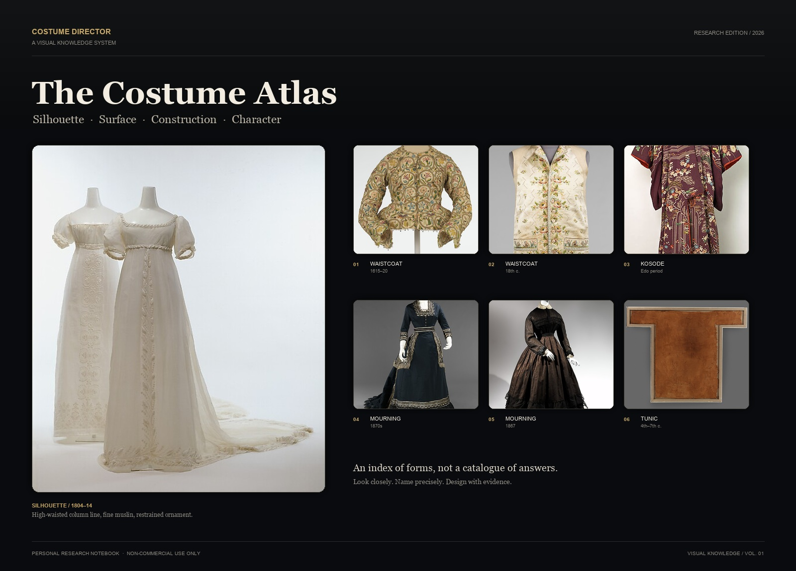
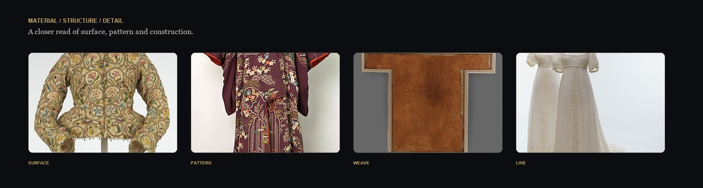
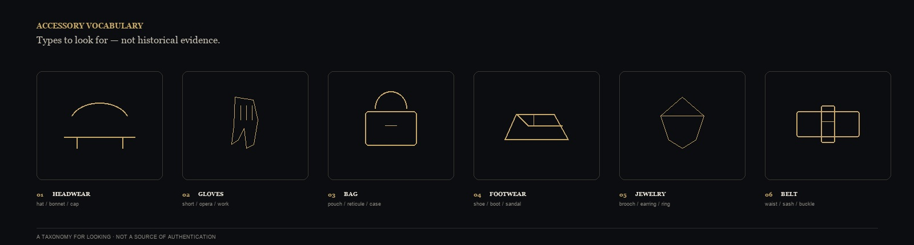
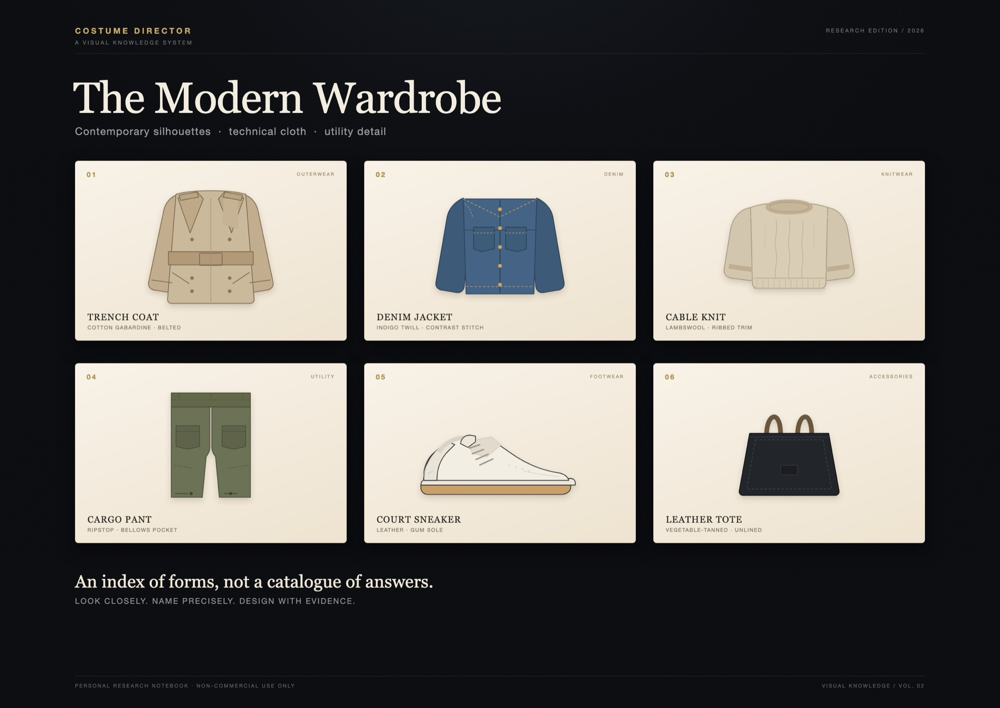

<p align="center">
  
</p>

<h1 align="center">Costume Director</h1>

<p align="center">
  <b>服装视觉知识库 · 角色造型研究笔记</b><br>
  <sub>Silhouette · Surface · Construction · Character</sub>
</p>

<p align="center">
  <a href="README.md">中文</a> ·
  <a href="README.en.md">English</a> ·
  <a href="README.ko.md">한국어</a> ·
  <a href="README.ja.md">日本語</a> ·
  <a href="README.fr.md">Français</a>
</p>

<p align="center">
  <sub>个人研究项目 · 非商业使用 · Obsidian + Markdown + DSH Skill</sub>
</p>

<p align="center">
  <sub>DSH ecosystem: <a href="https://github.com/YanKaFei/Costume-Director-Vault-Starter">Costume Director</a> · <a href="https://github.com/YanKaFei/art-aesthetic-vault">Art Aesthetic Vault</a> · <a href="https://github.com/YanKaFei/ascii-h3-director">ASCII H3 Director</a> · <a href="https://github.com/YanKaFei/2d-limited-mv-studio">2D Limited MV Studio</a> · <a href="https://github.com/YanKaFei/virtual-heroine-atlas">Virtual Heroine Atlas</a> · <a href="https://github.com/YanKaFei/smartstaff-ai-deepseek-plugin">SmartStaff AI</a></sub>
</p>

---

## 目录

- [关于](#关于)
- [为什么做这个仓库](#为什么做这个仓库)
- [一张图看全貌](#一张图看全貌)
- [数据快照](#数据快照)
- [仓库里有什么](#仓库里有什么)
- [知识结构](#知识结构)
- [视觉语言](#视觉语言)
- [核心能力](#核心能力)
- [怎么使用](#怎么使用)
- [质量与边界](#质量与边界)
- [使用声明](#使用声明)
- [项目状态](#项目状态)
- [DSH ecosystem](#dsh-ecosystem)

## 关于

Costume Director Vault Starter，服装视觉知识库，结构、材质、Prompt与角色造型研究笔记。它把服装结构、材质、单品、风格和完整造型整理成可检索的 Obsidian 卡片，并为每张卡补充视觉特征、英文生图提示词和参考图状态。它面向服装设计、角色造型与视觉研究，不是商业产品。

## 为什么做这个仓库

服装设计里最难的往往不是“知道一个名词”，而是把名词还原成可辨认的视觉事实：

- 这个领型具体怎么翻折、在哪个位置、和相近领型差在哪里；
- 这种材质在光线下是什么表面、什么垂坠、什么褶皱；
- 这件单品是什么廓形、什么比例、怎么穿；
- 这套造型由哪些上装、下装、外层、鞋履和配饰组成；
- 这些视觉判断，怎样变成可复现的提示词，而不是一堆形容词。

这个仓库试图把这些“看得见的知识”整理成一张可以反复查阅、组合和验证的工作台。

> 不是把服装写成标签，而是把标签还原成形状、重量、光线和人物。

## 一张图看全貌

<p align="center">
  
</p>

<p align="center">
  <sub>Surface / Pattern / Weave / Line — 从整体廓形进入局部结构。</sub>
</p>
<p align="center">
  
</p>

<p align="center">
  <sub>头饰、手套、包袋、鞋履、珠宝、腰带——这是观察索引，不是历史实物证据。</sub>
</p>


<p align="center">
  
</p>

<p align="center">
  <sub>现代衣橱：风衣、丹宁、针织、工装裤、球鞋、托特包——当代廓形、表面与功能细节。</sub>
</p>

## 数据快照

截至 2026 年 11 月，仓库收录：

| 卡片类型 | 数量 |
|---|---|
| 单品 garment | 92 |
| 结构 garment_part | 35 |
| 材质 / 纹样 material · pattern | 19 |
| 风格 style | 26 |
| 造型 look | 35 |
| 剧情场景 scene | 16 |
| 时代地域 period_region | 11 |
| 来源 source | 239 |
| **合计** | **473** |

- 英文提示词：218 张卡片
- 参考图登记：15 条，其中 7 张本地 CC0 预览

## 仓库里有什么

| 模块 | 内容 | 你可以用它做什么 |
|---|---|---|
| **结构卡** | 领型、袖型、门襟、褶裥、腰线、袖口、裙撑等结构单元 | 比较相近结构，找到决定性的几何差异 |
| **材质卡** | 纤维、组织、表面、光泽、垂坠、厚薄与动态 | 把“看起来像”拆成可验证的材质特征 |
| **单品卡** | 上装、下装、连身装、外套、鞋履、帽饰与配饰 | 从单品进入版型、结构和穿着方式 |
| **风格卡** | 历史风格、当代风格、亚文化与戏剧造型语言 | 理解比例、色彩、材质组合与时代语境 |
| **造型卡（Outfit）** | 完整人物造型、场景、角色、鞋履、配饰与跨镜连续性 | 把单品组合成可拍摄、可生成、可复用的造型 |
| **视觉提示词** | 英文结构、材质、单品、风格与造型提示词 | 复制到生图工作流，或作为视觉沟通文本 |
| **参考图状态** | 已核验参考图、待补图、缺图原因 | 区分“有图”“有许可”“已关联”“已在 Obsidian 显示” |

## 知识结构

仓库不是一堆孤立卡片，而是一条从“人”到“物”的链：

```text
角色 / 场景
    ↓
完整造型 Outfit
    ↓
上装 · 下装 · 外层 · 鞋履 · 配饰
    ↓
结构 / 材质 / 纹样
    ↓
视觉特征 · 英文提示词 · 参考图状态
```

每张卡尽量保留证据等级、适用范围与不确定性。**未知就是未知**：没有可靠依据的纤维、克重、织法、透明度或历史细节，不会被写成确定事实。

## 视觉语言

这不是一套“复古滤镜”，而是一套为服装阅读服务的设计系统：

| 设计元素 | 取值 | 用途 |
|---|---|---|
| Obsidian Black | `#090B0E` | 主背景，像舞台暗场 |
| Parchment | `#F3ECE0` | 正文与标题，像纸样与手稿 |
| Antique Gold | `#C8A96A` | 索引、编号、重点标记 |
| Graphite | `#2A2B2E` | 分隔线、卡片边界 |
| Display Serif | Georgia / 宋体 | 标题与叙事 |
| Work Sans | Arial / 系统无衬线 | 标签、参数、说明 |

版式遵循“先看整体，再看局部”：一张主视觉建立廓形，一条细节带进入材质与结构，最后用卡片和表格承载可检索的信息。

## 核心能力

### 01 · 结构辨识

把“领子”“袖子”“褶”拆成具体部位、几何形状、连接方式与正侧背视角，而不是只给一个名称。

### 02 · 材质阅读

从表面组织、光泽、纹理尺度、透光性、垂坠与运动行为描述材质；没有证据的物性保持 `unknown`。

### 03 · 单品到人物

从一件单品的版型、长度、松量、肩腰臀比例，推到完整穿着状态，再进入角色与场景。

### 04 · 完整造型

用上装、下装、外层、鞋履、配饰、色彩与轮廓组成一套造型，并保留角色身份、叙事语境和跨镜一致性。

### 05 · 风格比较

比较不同风格的比例关系、色彩组织、材质组合和典型单品，避免“只换名字”的同质化描述。

### 06 · 提示词表达

用模块化的英文提示词表达 `SUBJECT / STRUCTURE / MATERIAL / COLOR / LIGHT / CAMERA / BACKGROUND / STYLE / NEGATIVE / CONSISTENCY`，让视觉判断可以被复制、修改和验证。

## 怎么使用

### 在 Obsidian 中

1. 用 Obsidian 打开仓库根目录；
2. 从 `00-系统/MOC` 进入总览；
3. 沿 `风格 → 造型 → 单品 → 结构 / 材质` 向下阅读；
4. 在卡片内查看视觉参考、英文提示词与相关卡片；
5. 图片使用相对路径，迁移仓库时保持一致目录结构。

### 在 DSH / Agent 中

用自然语言直接提问，例如：

- “比较两种领型的结构差异，给我卡片 ID、英文提示词和参考图状态。”
- “为一位 1930 年代上海女性知识分子做一套完整造型，列出上装、下装、鞋履、配饰和跨镜锚点。”
- “这件单品的材质在光线下应该是什么表面？没有依据的部分请标 unknown。”
- “把现代极简和解构应用到同一个人物，给出两套结构明显不同的方案。”

Agent 应返回真实卡片 ID、证据状态、参考图状态和提示词；**不应把文本生成说成图片生成**。

## 质量与边界

| 维度 | 当前状态 |
|---|---|
| 文本与结构检查 | 已建立 |
| 专业领域审核 | 待逐卡人工审核 |
| 真实生图测试 | 未执行（当前环境无授权生图工具） |
| 人工视觉签核 | 未执行 |
| 历史 / 文化准确性 | 需结合来源与专业判断逐条复核 |
| GUI 验收 | 未执行 |

这个仓库是**研究工作台**，不是历史教科书、版权授权书、专业服装顾问意见或商业交付物。提示词通过文本检查，不等于图像生成准确；有参考图，不等于可以商用。

## 使用声明

**本仓库为个人、非商业研究笔记，仅供学习、研究与个人创作参考。**

- 不得用于商业演出、影视项目、客户项目、付费课程、付费模板、转售或任何以盈利为目的的分发；
- 不得将仓库内容用于商业模型训练、批量抓取或再分发；
- 仓库内容不构成对任何第三方素材、图像、品牌或历史资料的授权；
- 如需商业使用，请自行取得相关权利与专业许可；
- 如不确定某张图或某段描述能否使用，请把它当作“仅供查阅的参考”，不要复制、嵌入或再发布。

**No commercial licence is granted.** 本仓库不授予商业使用许可，也不替代版权、历史或法律意见。

## 项目状态

- 版本：**R1.3B / Research Edition**
- 形态：Obsidian Markdown + DSH Costume Director Skill
- 范围：结构、材质、单品、风格、完整造型、视觉提示词
- 当前重点：参考图证据、Prompt 专业差异、真实生图与人工视觉验收
- 原则：**先证据，后表达；先结构，后形容；先可验证，后可复用。**

---

<p align="center">
  <sub>Costume Director · A personal visual research notebook · Non-commercial use only</sub>
</p>

## DSH ecosystem

- [Costume Director Vault Starter](https://github.com/YanKaFei/Costume-Director-Vault-Starter) — costume visual knowledge skill
- [Art Aesthetic Vault](https://github.com/YanKaFei/art-aesthetic-vault) — visual style layers
- [ASCII H3 Director](https://github.com/YanKaFei/ascii-h3-director) — ASCII / kinetic-typography direction
- [2D Limited MV Studio](https://github.com/YanKaFei/2d-limited-mv-studio) — 2D anime MV prompt package
- [Virtual Heroine Atlas](https://github.com/YanKaFei/virtual-heroine-atlas) — virtual character design research
- [SmartStaff AI](https://github.com/YanKaFei/smartstaff-ai-deepseek-plugin) — restaurant workforce SaaS test framework
